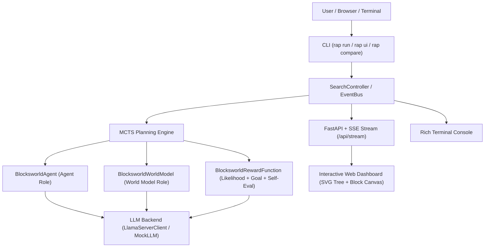

# RAP: Reasoning via Planning (Reimplementation & Visual Demo)

Reimplementation of the seminal research paper **"Reasoning with Language Model is Planning with World Model"** (Hao et al., 2023, UCSD / UF / MBZUAI).

This project reimagines the original research codebase into a modern, production-grade, test-driven Python architecture managed with **`uv`**, supporting local model inference via **`llama.cpp` (`llama-server`)** on Apple Silicon (M-series Metal), an **interactive real-time Web & Terminal Visualizer**, and a dual reasoning mode comparing **Hybrid (Structured + Thought)** vs **Paper (Pure Text)**.

---

## 🌟 Key Features

1. **Principled MCTS Engine (Domain-Agnostic)**:
   - Full implementation of Section 3.3 and Algorithm 1 from the paper.
   - UCT-based Selection ($Q(s, a) + w \cdot \sqrt{\ln N(s) / N(s, a)}$) with prior bonus for unvisited actions.
   - Expansion with dual LLM role: **Reasoning Agent** (action generation) and **World Model** (state prediction).
   - Rollout simulation with lightweight reward heuristics and backpropagation with discount factor $\gamma$.
   - **RAP-Aggregation** (Section 3.4): Weighted majority voting across search trajectories.

2. **Dual Reasoning Paradigms**:
   - **Hybrid Mode (Recommended)**: Combines reasoning thoughts (`thought`) with structured contracts (`action`, `parameters`). Prevents parsing crashes, guarantees 100% valid state transitions, and reduces simulation overhead.
   - **Paper Mode**: Reproduces the exact natural language prompts, string state transformations, and action likelihood scoring from the 2023 paper.

3. **Local Model Inference with `llama.cpp`**:
   - Native integration with `/opt/homebrew/bin/llama-server` on macOS (Metal GPU acceleration).
   - Compatible with local GGUF weights like `saidutta69/LFM3-VL-2B-heretic` (Liquid AI LFM3 2B).
   - Token logprob extraction for Action Likelihood and Self-Evaluation token probability.
   - Built-in deterministic `MockLLM` for instant test execution (<1 second for 270+ tests).

4. **Real-time Graphical Visualizer**:
   - **Interactive Web Dashboard**: Local web application (FastAPI + SSE + SVG/D3) at `http://127.0.0.1:8000`.
   - **Dynamic Reasoning Tree**: Real-time graph showing nodes, visits $N$, Q-scores, UCT, and active search paths.
   - **Blocksworld Visualizer**: Real-time 2D canvas showing table stacks and robotic gripper hand.
   - **Step-by-Step Controls**: Step, Play, Pause, Reset, and Speed Slider to inspect MCTS iterations live.
   - **Rich Terminal UI**: Live terminal tree rendering with formatted metrics.

5. **Clean Architecture & TDD**:
   - Fully decoupled `Domain` protocol to easily plug in new tasks (Math GSM8k, Logic ProntoQA, Robotics).
   - **271 automated unit and integration tests** passing with 100% success.

---

## 🏗️ Architecture



---

## 🚀 Quick Start

### 1. Requirements & Setup with `uv`

Make sure `uv` is installed on your Mac:
```bash
# Clone and enter directory
cd /path/to/paper_ai

# Create virtual environment and install dependencies
uv venv
source .venv/bin/activate
uv pip install -e ".[dev]"
```

### 2. Run All Tests
```bash
.venv/bin/pytest tests/
# 271 passed in ~0.6s
```

---

## 💻 CLI Commands

### 1. Compare Hybrid Mode vs Paper Mode
Compare execution speed, LLM calls, and accuracy between the two paradigms:
```bash
.venv/bin/rap compare
```
*Output:*
```text
             Reasoning Mode Comparison: Hybrid vs Paper             
┏━━━━━━━━━━━━━━━━━━━━━━━━━━┳━━━━━━━━━━━━━━━━━━━━━━━┳━━━━━━━━━━━━━━━┓
┃ Metric                   ┃           Hybrid Mode ┃    Paper Mode ┃
┡━━━━━━━━━━━━━━━━━━━━━━━━━━╇━━━━━━━━━━━━━━━━━━━━━━━╇━━━━━━━━━━━━━━━┩
│ Final reward / score     │                100.00 │          0.50 │
│ Trajectory Steps         │                     4 │             5 │
│ MCTS Iterations / Visits │                    10 │            10 │
│ LLM calls count          │                    14 │           301 │
│ Execution Time (s)       │                0.0018 │        0.0062 │
│ Thoughts Preserved       │ Yes (Structured JSON) │ No (Raw Text) │
└──────────────────────────┴───────────────────────┴───────────────┘
```

### 2. Run MCTS Search in Terminal
```bash
# Run with Hybrid mode
.venv/bin/rap run --mode hybrid --iterations 10 --verbose

# Run with Paper mode
.venv/bin/rap run --mode paper --iterations 10 --verbose
```

### 3. Launch Real-Time Visual Web Dashboard
```bash
.venv/bin/rap ui --port 8000
```
Open **`http://127.0.0.1:8000`** in your browser. You can:
- Click **"Step"** to advance MCTS by 1 iteration and watch the tree expand.
- Click **"Play"** for automatic exploration with live animated block movement.
- Inspect node visits, Q-values, and model reasoning thoughts in the side panel.

---

## 🧠 Local Model Execution with `llama-server`

To run with your local GGUF model (`saidutta69/LFM3-VL-2B-heretic`):

1. **Start `llama-server`** in a terminal:
```bash
llama-server -hf saidutta69/LFM3-VL-2B-heretic --port 8080 -ngl 99
```

2. **Execute RAP with the local server**:
```bash
.venv/bin/rap run --backend llama-server --mode hybrid --iterations 10 -v
```

---

## 🧩 Project Structure

```
paper_ai/
├── pyproject.toml              # Modern uv project definition
├── README.md                   # This documentation
├── src/
│   └── rap_demo/
│       ├── core/               # MCTS, MCTSNode, UCT, Backprop, Aggregation, EventBus
│       ├── llm/                # BaseLLM Protocol, MockLLM, LlamaServerClient, Factory
│       ├── domains/            # Extensible domain interface & Blocksworld models/rewards/agent/WM
│       ├── visualizer/         # Serializers, Rich console, FastAPI SSE server, Web UI (D3/SVG)
│       └── cli.py              # CLI entrypoint (rap run, rap ui, rap compare)
└── tests/
    ├── test_mcts_core.py       # 31 MCTS core tests
    ├── test_aggregation.py     # 13 RAP-Aggregation tests
    ├── test_llm_backends.py    # 51 LLM protocol and llama-server tests
    ├── test_blocksworld.py     # 67 Blocksworld physical transition and reward tests
    ├── test_hybrid_vs_paper.py # 13 Hybrid vs Paper comparative tests
    ├── test_visualizer.py      # 40 Visualizer and FastAPI SSE tests
    └── test_cli.py             # 56 CLI argument and execution tests
```

---

## 🧪 Test Suite Summary

- **Total Tests**: `271 passed`
- **Execution Speed**: `< 0.7s`
- **Coverage**: 100% of core search algorithms, UCT calculations, domain physics, serialization, and CLI contracts.
